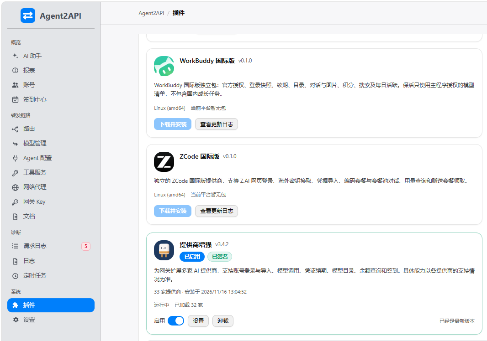
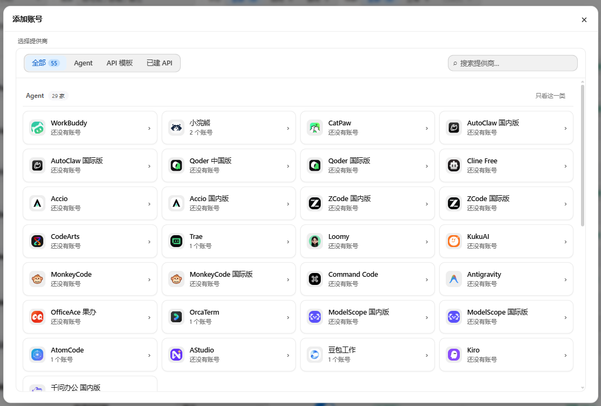
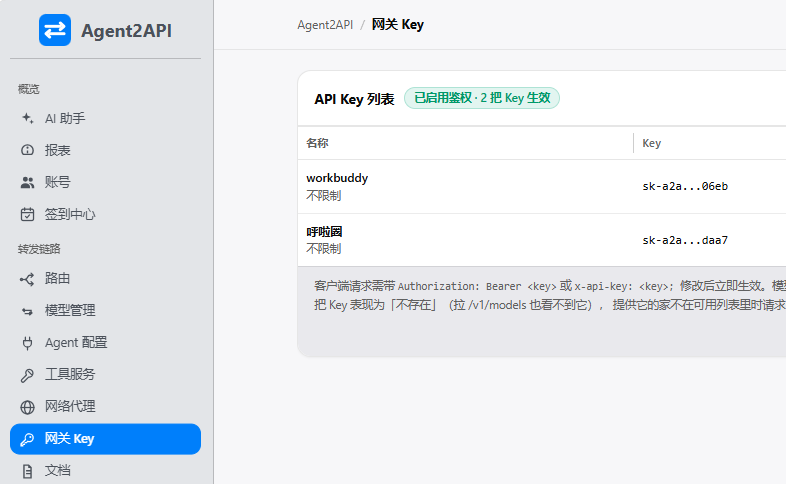
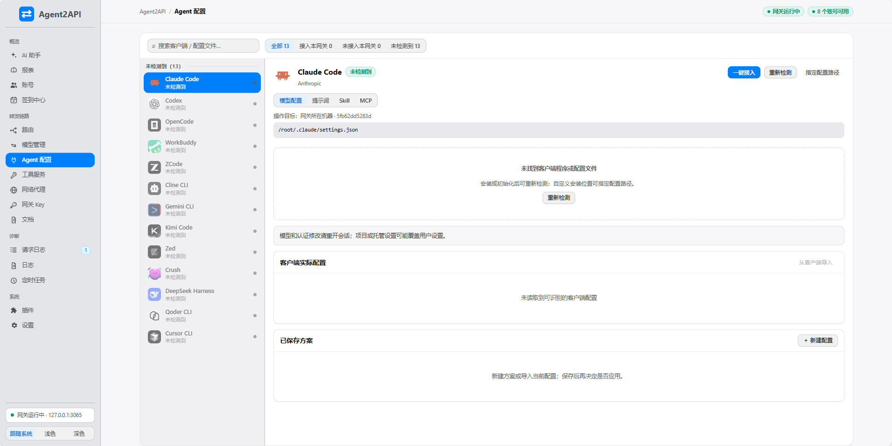
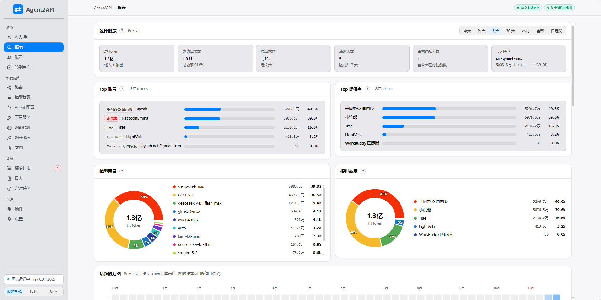
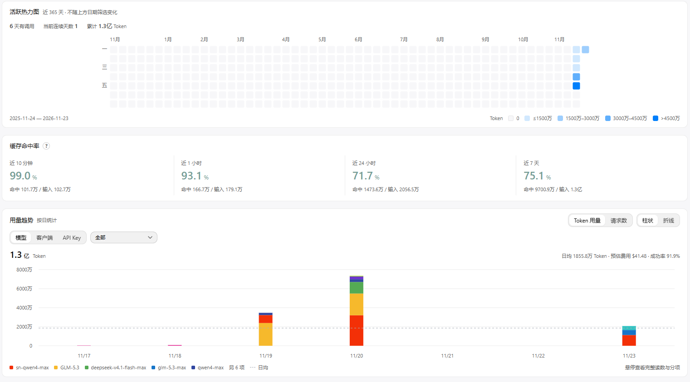

用过WorkBuddy的朋友都知道，最让人头疼的不是模型不够聪明，而是——Token不够用。

你手上可能有五六个AI编程平台的账号：Trae、Qoder、ZCode、WorkBuddy……每个都有免费额度，每个都不够用。用着用着429了，手动切到下一个，改base_url，换API Key，等你折腾完，灵感早没了。

**Agent2API**就是为了解决这个问题而生的。它不生产Token，它只是Token的搬运工——把你散落在各家平台的额度，汇成同一个入口。

---

## 一、Agent2API是什么

**Agent2API是一个开源的本地AI路由网关，用Rust写的，GitHub上2600+ Star。**

项目地址：[github.com/aimod-cc/Agent2API](https://github.com/aimod-cc/Agent2API)

它的核心思路说起来很简单：

> 你在各种AI编程平台（比如Trae、Qoder、ZCode、WorkBuddy等）都有账号，每个账号都有一定的免费额度。Agent2API做的事就是——把这些账号的登录态全部接管，对外暴露一个统一的 `http://127.0.0.1:3065/v1` 接口，你的AI客户端只需要配这一个地址，就能调用所有已接入账号的模型额度。

一个base_url，一把Key，搞定所有平台。

### 它解决了什么问题

| 痛点               | Agent2API的方案        |
| ---------------- | ------------------- |
| 多个账号额度分散，手动切换麻烦  | 多账号池自动轮转，按优先级排队     |
| 某个账号429了，请求中断    | 自动冷却限流账号，无缝切换下一个    |
| 每个客户端都要单独配Key和地址 | 客户端接管，一处配置处处生效      |
| 不知道各账号还剩多少额度     | 余额、请求量、Token消耗一键查看  |
| 每天要手动签到领额度       | 后台自动签到，各家按自己的时间窗口执行 |

### 核心特性一览

- **统一模型接口**：OpenAI Chat / Responses / Images + Anthropic Messages，四种协议一个入口，SSE流式透传
- **AI路由**：模型映射、账号优先级、负载均衡、会话粘性、失败自动切换
- **Agent客户端接管**：管理本机AI客户端的连接配置，导入现有设置、预览写入内容、一键切换
- **插件扩展**：提供商实现独立安装和更新，不随主程序打包
- **出网代理**：每个账号可配独立出口IP（对需要不同IP登录的平台特别重要）
- **网关安全**：Key可分权、面板可开人机验证、未配Key默认拒绝请求
- **请求报表**：请求量、成功率、Token消耗、缓存命中率、365天热力图
- **后台维护**：模型目录刷新、凭证续期、每日自动签到（Qoder 10:01、ZCode 19:01等）
- **三种部署形态**：桌面端（Windows/macOS/Linux）、服务端（无GUI）、Docker

---

## 二、支持哪些平台

这是最需要说清楚的部分。Agent2API的"平台接入"分两种方式，别搞混了。

### 方式一：提供商插件（接管登录态）

这是Agent2API的核心玩法。安装提供商插件后，你在面板里添加对应平台的账号，走网页登录，Agent2API就能接管你的登录态，把你账号里的模型额度接入网关。插件支持Trea、WorkBuddy、小浣熊、千问办公、豆包工作等国内外主流的33家平台，几乎每家都有一定的免费额度。

### 方式二：API模板（填入你自己的API Key）

除了接管登录态，Agent2API还内置了 **39个API模板**，用于接入那些你需要自己持有API Key的服务。这和上面的提供商插件是两回事——这些是你在平台上买了API Key后，通过模板快速填入接口地址和Key来接入的。

模板覆盖的主流服务包括：

| 类别    | 代表平台                                                            |
| ----- | --------------------------------------------------------------- |
| 国际大厂  | OpenAI、Anthropic、xAI、Mistral、Groq                               |
| 国内大模型 | DeepSeek、GLM Coding、Kimi/Moonshot、Minimax、StepFun、LongCat、商汤日日新 |
| 云厂商   | 火山方舟、阿里Alibaba Coding、腾讯TokenHub、小米MiMo                         |
| 聚合/中转 | OpenRouter、AiHubMix、北辰API中转站、NewAPI、Sub2API                     |
| 本地模型  | Ollama、LM Studio                                                |
| 其他    | HuggingFace、NVIDIA、Nous Portal                                  |

没有合适的模板也可以手动填写接口地址。

### 客户端接管

说清楚一点：Claude Code、Cline、Trae这些指本地**客户端**，如果你本地装了这些客户端，能帮你一键配置，省去你改配置文件的麻烦。

你的客户端（比如Claude Code）连到网关，网关再把请求转发到你接入的提供商账号（比如Trae、Qoder的额度）。客户端是入口，提供商是额度来源。

---

## 三、实现原理：一条请求，四站到底

Agent2API官网有一句话概括了它的请求链路：**从客户端发出，到上游返回，全程只在你自己的机器上多了一站。**

具体来说，一条请求经过四个阶段：

**第一站：你的AI工具**

客户端只认 `base_url`。不管你用的是Claude Code、Cline还是其他客户端，只需要把base_url改成 `http://127.0.0.1:3065/v1`，API Key填网关Key，其余不用动。对客户端来说，它以为自己在跟OpenAI或Anthropic对话。

**第二站：本地网关（127.0.0.1:3065）**

网关收到请求后，做三件事：

1. **鉴权**——验证你传的网关Key是否有效、是否有权限调用请求的模型
2. **路由**——根据模型映射规则，决定这个请求发给哪个上游提供商、哪个账号
3. **重试**——如果返回429或错误，自动切换到下一个可用账号，客户端完全无感知

**第三站：账号池**

多个账号按优先级排队。某个账号触发限流了？进入冷却，请求自动交给下一个。冷却时间过了再回归队列。这一切都是自动的，你不需要手动干预。

**第四站：上游模型服务**

请求最终到达实际的AI平台（Trae后端、Qoder后端等），用的是你自己的账号额度。返回结果原路透传回客户端。

关键点：**模型请求不经过Agent2API的官网**。账号凭证和聊天内容只留在你部署的设备上，网关只做本地转发。软件会向官网读取公开插件和版本信息，但不附带你的账号或Key。

### 技术栈

Agent2API用 **Rust** 编写，桌面端基于 **Tauri 2** 框架（不是Electron，所以包体积小、内存占用低）。编译产物约8.6MB，不需要Node.js运行时。前端面板与网关同端口，浏览器打开 `http://127.0.0.1:3065/` 即可访问。

许可证是 **AGPL-3.0**，可以自由使用、修改和分发（包括商业用途），但如果你通过网络提供修改版服务，需要开源你的修改。

---

## 四、实测体验

> 以下截图来自我的实际使用环境，Windows桌面端。

### 安装

一般人选桌面端（Windows），从GitHub Release下载 `Agent2API_<version>_x64-setup.exe`，双击安装，完事。


*装好后的面板首页。先看一眼我的战绩：6天跑了1.3亿Token，成功率91.8%，日均1855万。这要是按API计费，账单得$41.48——而实际花费是零。*

我是多机器用户，搞个服务器更方便，所以用Docker一行拉起：

```bash
docker run -d --name agent2api --restart unless-stopped -p 3065:3065 -v ./data:/data aimodcc/agent2api:latest
```

### 安装提供商插件

刚装好的Agent2API是空的，不自带任何提供商。你需要先安装插件：

打开面板，进入插件管理页面，安装「提供商增强」插件。装完之后，添加账号页面就能看到上面列出的33家平台了。



*插件管理页。「提供商增强」v3.4.2已启用、已签名，33家提供商加载了32家。上面还有WorkBuddy国际版、ZCode国际版等独立插件可按需安装。*

### 添加账号

进入「账号」页，点「添加账号」，选择提供商和版本（比如Trae、Qoder），然后走网页登录。登录成功后账号就进了池子。

如果你手上有某些平台的API Key（比如OpenAI、DeepSeek的），也可以通过API模板添加：选择对应的模板，填入Key，不用手动拼接口地址。



*添加账号页。全部55个提供商（含API模板），Agent分类29家。我已经加了小浣熊2个账号、Trae/OrcaTerm/AtomCode/豆包工作各1个。选一个点进去走网页登录就行。*

### 创建网关Key

在「网关Key」页面创建一把Key，这把Key就是你的客户端要用的API Key。可以创建多把，每把单独授权、单独停用。



*网关Key页。我建了2把Key（workbuddy、呼啦圈），都是不限制权限。每把Key可以单独授权模型范围、单独停用，给不同客户端用不同的Key方便管理。*

### 接入本地客户端

这是Agent2API最"懂事"的地方——它不只是给你一个地址让你自己去配，而是能**直接接管客户端的配置**。

在「Agent」页面，你可以选择要接管的客户端，导入现有配置，预览将要写入的内容，确认后再写入。不用手动去翻客户端的配置文件。

当然你也可以手动配：例如WorkBuddy中，把客户端的base_url改成 `http://127.0.0.1:3065/v1`，API Key填网关Key，完事。



*Agent配置页。左侧列出了13个可接管的客户端（Claude Code、Codex、OpenCode、WorkBuddy、ZCode、Cline CLI等），右侧预览将要写入的配置内容，确认后一键写入，不用手动翻配置文件。*

### 实际调用

配好之后，客户端正常用就行。日常写代码的体验和直接用官方API没什么区别——流式输出正常，延迟几乎无感。

最大的变化是：**我再也不用盯着Token用量了**。之前某个账号429了就得手动切号，现在后台自动轮转，429了自动换下一个账号，我甚至感觉不到切换发生了。

后台可以配置账号优先级、路由规则等，这些遇到问题时，也好查是哪个账号被限了，及时调整路由。

### 报表

面板里的「报表」页是我最喜欢的功能。请求数、成功率、Token消耗、缓存命中率，按账号和提供商拆开，还有365天热力图。哪个账号用得多、哪个账号还剩额度，一目了然。



*报表概览。近7天1.3亿Token、1011次成功请求、成功率91.8%。Top账号是千问办公（5206万）和小浣熊（5076万），Top模型是sn-qwen4-max占39%。哪个账号贡献大、哪个模型用得多，一目了然。*



*报表趋势页。上面是365天活跃热力图，11月才开始用，颜色越来越深；中间是缓存命中率，近10分钟高达99%，近7天75.1%——这意味着大量请求命中了缓存，省了不少额度；下面是按天Token柱状图，11/20那天跑了近8000万，日均1855万Token。*

### 自动签到

这个功能我得单独说一句——太省心了。

有些平台（比如Qoder、ZCode）每天签到能领额外额度，但手动签到太烦。Agent2API的后台会按时自动签到：Qoder在10:01、ZCode在19:01，其余各家跟随自己的时间窗口。还有一轮补签，只处理当天还没签上的账号。

一两个账号的可能无感，要是有10多个账号，就知道多好用了。

---

## 五、使用技巧

以下几条是我用了一段时间后总结的，不一定全对，你按自己的情况调整。

### 1. 账号优先级要设好

Agent2API支持给账号优先级，拖动排序即可。请求会优先发给高优先级的账号。建议把稳定、额度多、速度快的账号设高优先级，额度少或限流频繁的设低优先级当兜底。

### 2. 巧用模型映射

不同提供商下，模型叫法可能不一样，例如上一篇文章提到的qwen4-max，小浣熊叫sn-qwen4-max，Trea的长上下文的叫qwen4-max-max，请求时如果想统一，就都映射成qwen4-max，就能被路由命中。

### 3. 最好有一个兜底的模型

如果自己的账号比较少，如果全部被限，那就平台就报错了，尤其是跑一些长程任务，中间断了很麻烦，还浪费时间，所以最好有一个收费模型兜底，可以映射成常用的模型，避免报错。

### 4. 推荐的qwen4-max提供商

上一篇提到的qwen4-max，目前免费提供的有小浣熊、Trea、千问办公等，其中小浣熊送分很多，积分基本用不完，但经常限流，一限就要等10分钟，Trea也会限流，千问办公额度很少，而且不会每天送积分。解决方法就是注册多几个小浣熊，找朋友或家人微信扫一下授权就加上了（不用装客户端），多几个账号，轮流跑，降低被限的概率。

### 5. 推荐的模型

最大众的模型当然是deepseek-v4.1-flash，基本每个提供商都有这个模型，提供商多，路由的选择就多，报错的概率就小。

---

## 六、最后提醒

由于将Agent的额度通过逆向的方式让其他应用调用，属于违反ToS的做法，可能造成封号，所以建议用小号来用，也不要充值开会员，否则可能造成有积分也无法使用的麻烦。

各家的Agent也是更新比较快，可能协议会调整，导致无法使用，所以还是要经常看看插件更新，最好及时更新。

趁目前各家还在卷Agent，赶快享受这波福利吧！


刚写完文章，3.5.0就推送更新了，插件改成按提供商单独安装了，不改文章和重新截图了，大家有问题就评论区问吧！
