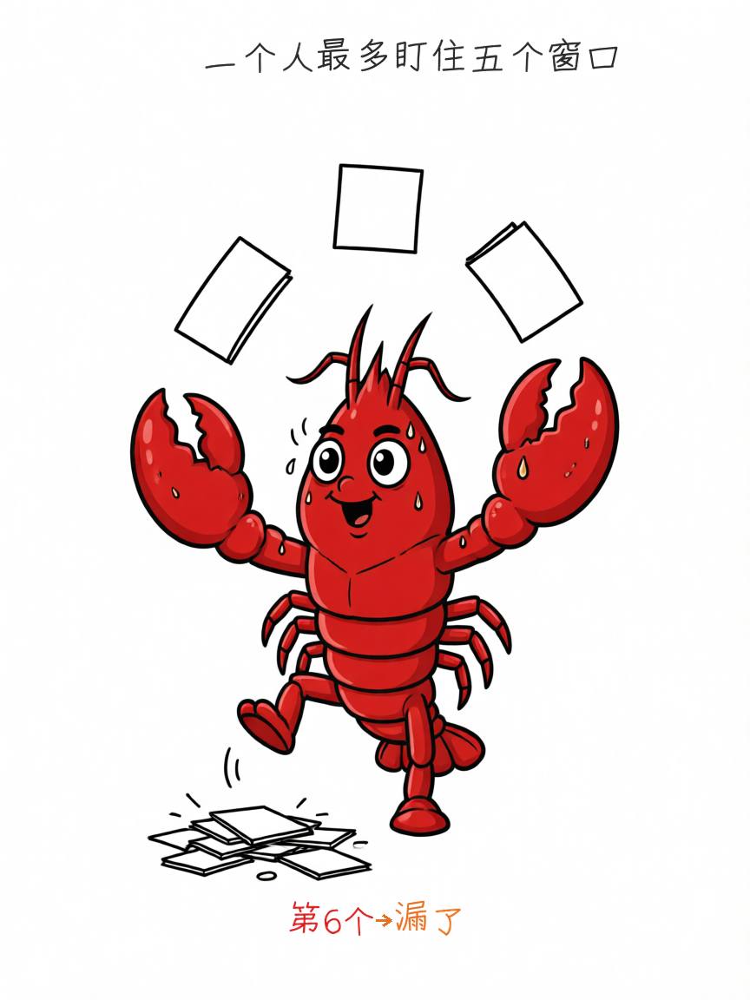
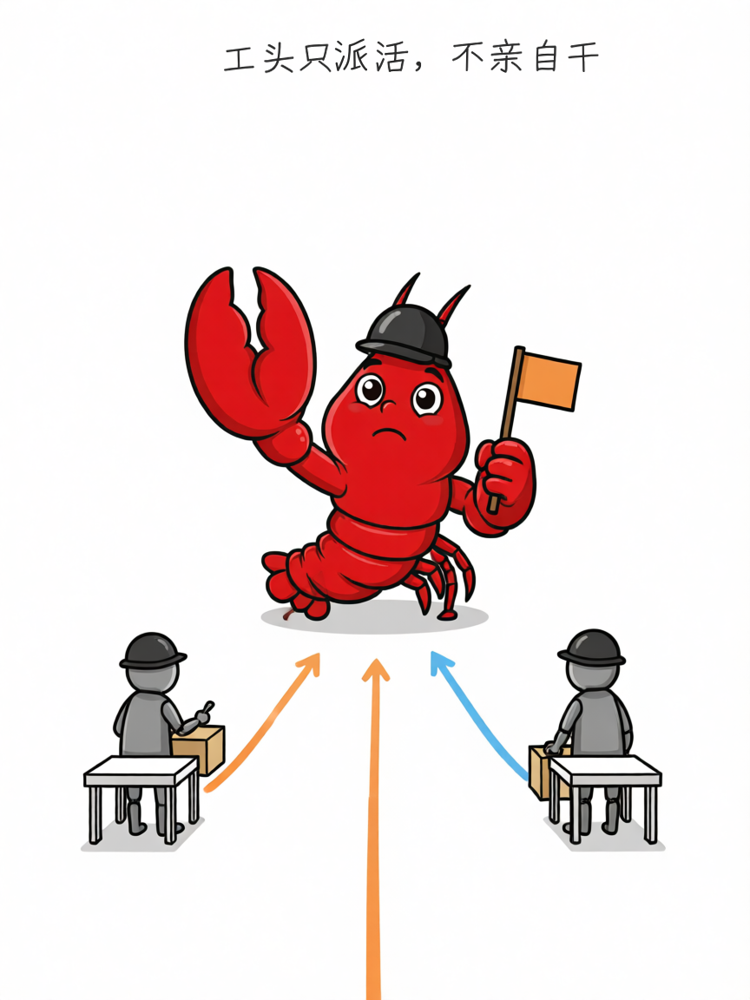
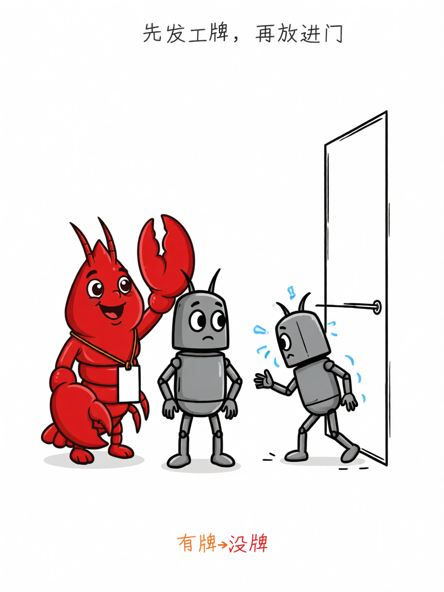
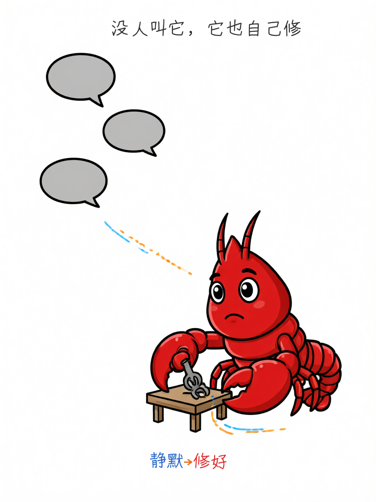
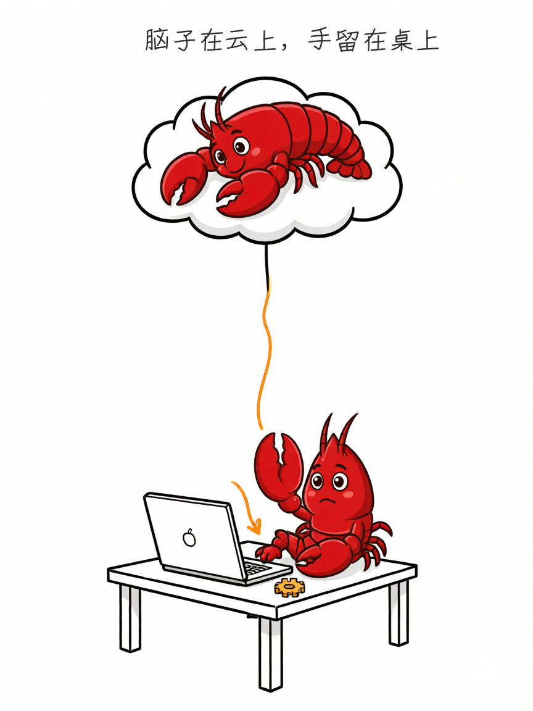
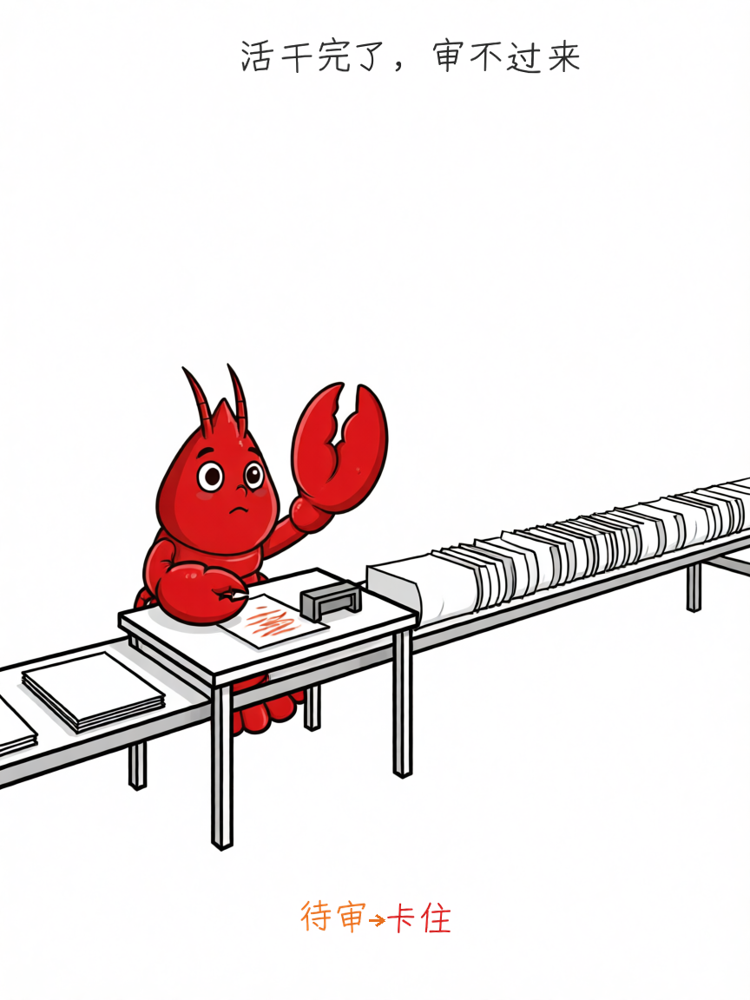

10 月 31 日晚，DeepSeek 发了一篇技术文章，讲他们正在做的 Super-Agent。

架构图可以跳过，记住一句话就够了：**单任务的上限，取决于模型；多任务的上限，取决于你的注意力。**

现在的 AI 助手，一个窗口干一件事。想并行？多开窗口。但 DeepSeek 观察到：一个人通常只能同时盯住 **3 到 5 个**窗口。开到第六个，你就开始忘事——这条消息属于哪个任务？那个改到哪一步了？

不是 AI 不行，是你的眼睛不够用。

## 解法很土：派个工头

一个常驻的「工头」守在所有入口，只负责接话、判断、派活；真正干活的是后面一排「工人」，每人一个独立上下文，互不打扰。工人干完向工头汇报，对外只由工头一张嘴说话——所以你看到的永远是一个 AI，背后其实站着一队。

有个细节特别妙：**这个工头，连命令行工具都不给它配。**

不是提示词里写「你别自己干」，是它压根没这个工具。所以它不会手痒抢活，也不会变成最堵的那一环。

能靠结构保证的事，别指望自觉。

顺带说个很清醒的成本安排：工头用便宜的小模型就够（它的活儿是判断和派活，不需要深度推理），贵的模型留给工人——因为工人的产出直接决定活干得好不好。

## 第二个动作：发工牌

工人不是想干啥就干啥。每接一个活，系统发一张「授权卡」：谁让干的、能干到哪、依据哪条规矩。卡不可改——想扩大范围，重新开一张；也不会自己过期，只有人喊停才收回。

还有一条很实在：群里没人 @ 它，它默认不动。想让它主动干活，得先写规则，而且这条规则要**先在「只记录、不动手」的模式下跑一遍**，看它想干什么，再决定放不放。

先让它只说不做，比一上来就放手靠谱。

不过这张卡管得住「能碰什么」，管不住「为什么碰」。它被一条注入的评论带偏方向时，动作仍在授权范围内——这是所有授权模型的共同漏洞。

## 新特性一：它自己找活干

群里有人报了个 bug，没人 @ 它。它在后台悄悄复现、翻代码、找修法——**只有确认问题、找到简单修法，才冒出来说一句「修好了」；没把握就全程安静。**

这才是主动性该有的样子。AI 的主动性如果变成刷屏，比不主动更烦人。

## 新特性二：你合上电脑，它还在跑

脑子（Agent 循环）搬到云上，手（你的开发机、凭据、没提交的改动）留在原地，中间只连一根细线。

所以笔记本合盖、人下班，任务照跑；设备重新上线，它接着干。以前 AI 是「你不在，它就死」；现在它只是「你不在，它不吵」。

## 真正的问题：审不过来

AI 能同时推十个任务之后，你不再缺「执行」，你缺「验收」。

以前在五个窗口之间来回切，累的是手；现在十个结果同时摆在面前，累的是脑子——每个都得看改动、判断有没有越界、确认测试真跑过。

**瓶颈没消失，只是从「切窗口」搬到了「审结果」。**

他们做过一组实验：模拟 300 条群聊和 CI 消息、其中 20 条是真活儿。这种架构把最慢那批任务的完成时间从 29.5 分钟压到 15.7 分钟——平均快不算本事，**把长尾压下去才是本事**。

代价是账单：多开工人，缓存读取的 token 涨了 37%。这笔交易划不划算，看你的注意力有多贵。

DeepSeek 自己也承认：跑上几个月，长程记忆会先崩；云端一旦被提示词注入攻破，它连着的所有设备都危险。

一句话：**AI 不缺脑子，缺的是排班表和工牌。** 而你要做的，是从「干活的人」变成「签字的人」——签字可比干活累。
