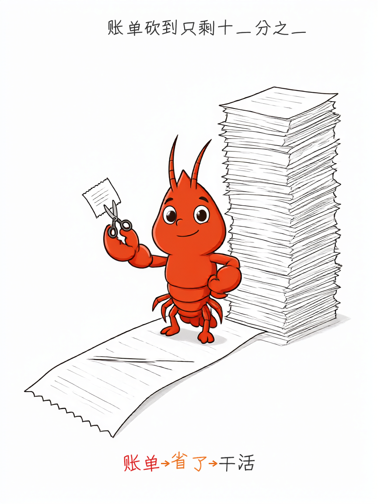
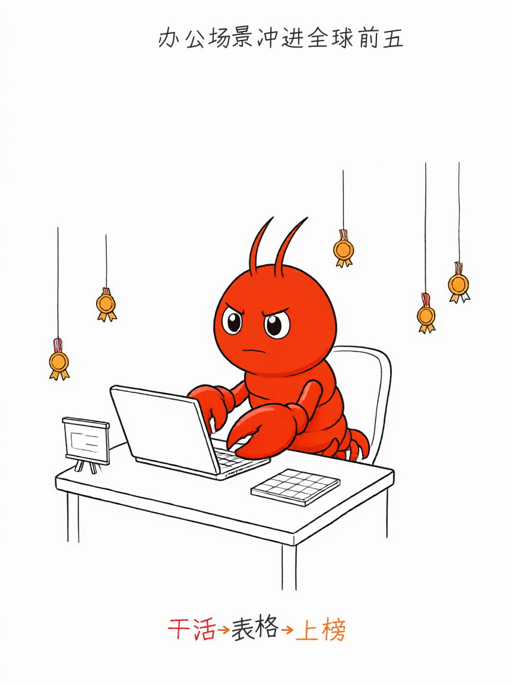
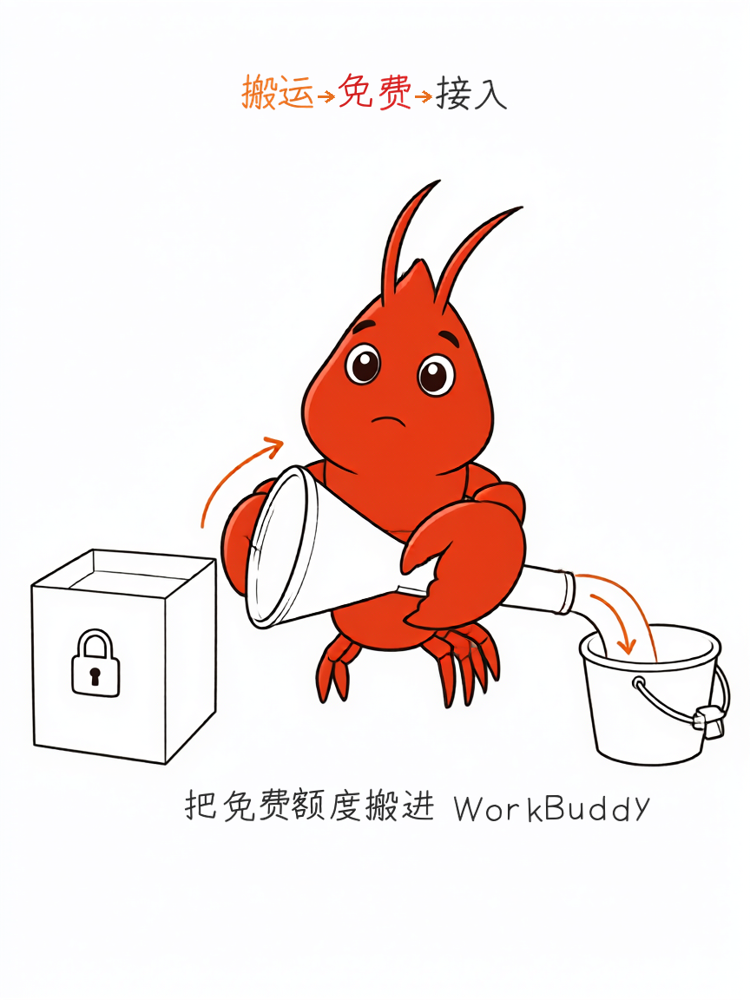

Qwen4-Max 不是"最强模型"——综合能力离 Claude Opus 5.5、GPT-6 Astra 还差一截。但它可能是**目前最划算的旗舰模型**：干同样的活，费用只有竞品的十分之一到四分之一，PPT、表格这些办公场景已经冲进全球前五。

便宜到什么程度？网友拿它和 Claude Opus 5.5 做同一个 3D 场景复刻任务，账单只有对方的**十一分之一**。

---

## 一、四个亮点

**1. 块头没变，干活更省。** 总参数 2.4 万亿和上代一样，但换了新架构，每次只激活 710 亿参数（少了 25%），Token 消耗减少 35-49%。成绩更好了，账单只剩原来的三分之一。

**2. 办公场景全球前五。** PPT 制作全球第 4，电子表格全球第 5（较上代提升了 30 个位次），前端 Web 开发全球第 6。这些不是跑分游戏，是实际工作中用得到的能力。

**3. 百万 Token 上下文，能看图能看视频。** 一次性塞进去几百页合同、上千张医学影像都不在话下。原生视觉，不是外挂。

**4. 先交作业，再改作业。** 传统 AI 干活像黑盒——你提交需求，它闷头做，最后甩给你一个结果。Qwen4-Max 换了个思路：先尽快交付一个能用的 v1，然后边干边吐进度，你随时挑毛病改要求，它顺着反馈推到 v7、v14。配套插件已开源。

---

## 二、和竞品比怎么样

| 维度 | Claude Opus 5.5 | GPT-6 Astra | Kimi K3.1 Pro | Qwen4-Max |
|---|---|---|---|---|
| 综合智能指数 | 59 | 57 | 46 | 43 |
| 输出价格（$/百万 Token） | ~$18+ | ~$45+ | ~$9+ | $4.5 |

上代 34 分，这次涨到 43 分，一口气提了 9 分。但距离第一梯队还有 14-16 分。

同套测试任务的花费：上代 $10.02，Qwen4-Max 只要 $3.27，**降了 67%**。上代平均输出 17.1 万 Token，它只要 10.5 万——少干了四成活，成绩还更好。

---

## 三、免费使用渠道

| 渠道 | 费用 | 适合 |
|---|---|---|
| **千问办公**（qwenwork.ai） | 免费，注册即用 | 办公/PPT/表格/Agent |
| **QwenStudio**（chat.qwen.ai） | 免费对话 | 快速体验 |
| **阿里云百炼** | 新用户送 100 万 Token | 开发者调 API |
| **千问 APP** | 免费 | 移动端 |
| **腾讯云 TokenHub** | 11/30 前 WorkBuddy 限时免费 | 接入 WorkBuddy |

---

## 四、用 Agent2API 把免费额度"搬运"到 WorkBuddy

千问办公、商汤小浣熊这些平台都内置了免费的大模型额度。但它们是封闭产品——你在千问办公里用 Qwen4-Max 没问题，想把这个免费额度拿到 WorkBuddy 等其他工具里用，官方不提供接口。

**Agent2API 就是解决这个问题的开源工具。**

原理：千问办公、商汤小浣熊在网页端调用模型时，背后走的是自己的接口。Agent2API 把这个过程反向工程，**把这些平台内置的免费额度，包装成标准的 OpenAI 兼容 API 对外暴露**。

你注册一个千问办公账号（免费额度）→ Agent2API 读取这个账号的额度 → 转成通用 API → 在 WorkBuddy 里填入这个 API 地址 → WorkBuddy 就用上了 Qwen4-Max，费用为零。

商汤小浣熊、QwenStudio 等平台同理。社区里已有 qwen2api、qwen-free-api 等多个开源项目在做这件事。

---

**如果你需要绝对最强的推理能力**，选 Claude Opus 5.5 或 GPT-6 Astra。
**如果你需要够用、便宜到可以随便试的旗舰模型来干实际工作**，Qwen4-Max 是当前性价比最高的选择。

想更深入了解 Agent2API 怎么部署、怎么接入 WorkBuddy？评论区留言，下篇就讲。
